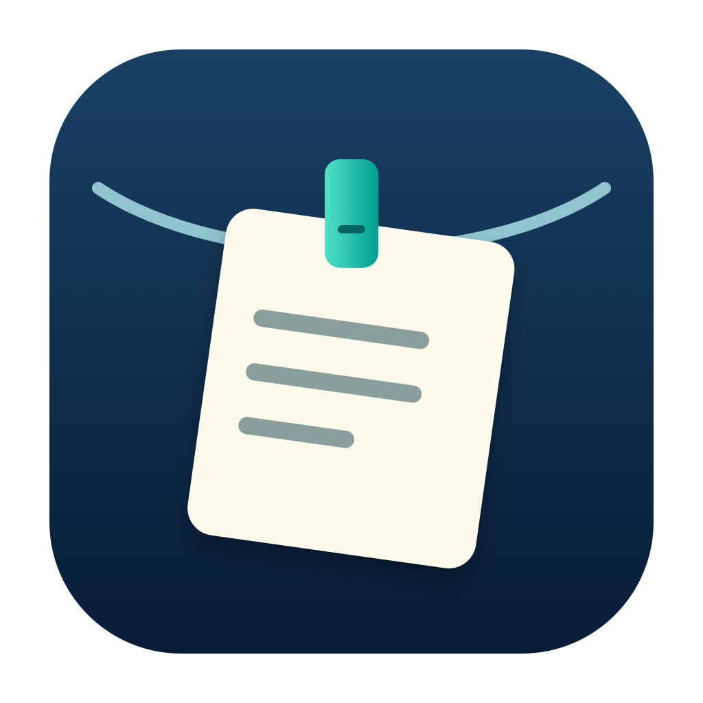

# 晾贴 · PegNest

把截图、复制的文字、链接和图片夹在桌面上方的晾衣绳上。点击重新复制，文字双击展开，滚动查看过去的内容。

适用于 macOS 14 或更高版本。原生 Swift、AppKit、SwiftUI，无第三方运行时依赖。



## 使用

- 首次从菜单开启「记录剪贴板历史」，从下一次复制开始记录。可随时暂停或清空。
- 默认保存最近 100 条，可选 25/50/100 或只保留屏幕容纳数量。
- 选择系统保存截图的目录，授权后新图片和录屏自动挂上。应用不修改系统截图设置。
- 点击复制，文字双击或长按展开；图片双击打开，长按使用默认图片应用，录屏长按打开裁剪。
- 私有副本删除后不会进入废纸篓；外部截图取下或淘汰不会删除原件。导出使用系统保存窗口。
- 将鼠标停在菜单栏，或使用默认 Control–Option–T 快捷键显示挂绳。

历史仅在本机保存，无账号、统计分析或开发者服务器。带 Concealed/Transient/AutoGenerated 标记的复制、文件复制及多项目复制会跳过。未标记的密码可能被记录。文字以原文保存（单条最多 1 MiB），富文本按纯文字处理；不会自动向其他应用粘贴。macOS 通用剪贴板由系统设置管理。

## 构建

```sh
swift test
swift scripts/check-strings.swift
scripts/build-app.sh debug
open build/PegNest.app
```

需要 Xcode。构建启用 App Sandbox，包含 arm64 和 x86_64，本地使用 ad hoc 签名。正式商店签名与 Archive/Export 操作见 [上架说明](docs/APP_STORE.md)。本机构建并不表示已提交或通过审核。

重新生成独立图标：`scripts/generate-icons.sh`。图标由全新几何绘制代码生成，没有使用上游图标或宣传图片。

## 开源来源

基于 Alejandro Buján 的 [Tendedero](https://github.com/alejandrobujan/tendedero) 独立修改。上游代码为 MIT；其名称、图标及 docs 图片不包含在该授权中。本产品使用独立名称和图标，不暗示原作者背书。完整版权和许可保留于 [LICENSE](LICENSE)，并打包到应用的「关于 / 隐私与开源许可」中。

[隐私说明](docs/PRIVACY.md) · [设计](docs/superpowers/specs/2026-10-11-pegnest-design.md) · [实现计划](docs/superpowers/plans/2026-10-11-pegnest.md) · [验证记录](docs/VALIDATION.md)
